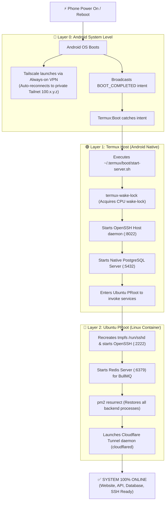

# Complete Autostart & Disaster Recovery Guide for Android VPS (Cold Reboot)

[**[🇻🇳 Đọc bản Tiếng Việt](../vi/autostart-services-guide.md)** • **[🏠 Home](../../README.md)**]

This guide provides an end-to-end configuration for an **unattended, fully autonomous recovery pipeline (Cold Reboot Autostart)** on an Android VPS. When the device loses power, restarts, or recovers from a dead battery, the entire stack—including **Tailscale**, **Termux SSH**, **native PostgreSQL**, **Ubuntu SSH**, **Redis**, **PM2 Backend apps**, and **Cloudflare Tunnel**—will automatically initialize within 30–45 seconds **without requiring manual physical interaction with the phone**.

---

## 📑 Table of Contents

1. [Cold Boot Sequence Architecture](#1-cold-boot-sequence-architecture)
2. [Layer 0: Android Operating System Hardening](#2-layer-0-android-operating-system-hardening)
3. [Layer 1: Termux:Boot Master Startup Script (`start-server.sh`)](#3-layer-1-termuxboot-master-startup-script-start-serversh)
4. [Layer 2: Ubuntu PRoot Unified Service Manager (`start-services.sh`)](#4-layer-2-ubuntu-proot-unified-service-manager-start-servicessh)
5. [Layer 3: PM2 Application State Persistence](#5-layer-3-pm2-application-state-persistence)
6. [Cold Reboot Verification Procedure](#6-cold-reboot-verification-procedure)
7. [Troubleshooting FAQ](#7-troubleshooting-faq)

---

## 1. Cold Boot Sequence Architecture



---

## 2. Layer 0: Android Operating System Hardening

To ensure Android does not kill background server processes or prevent services from launching at boot, configure the following three requirements:

### 2.1. Install `Termux:Boot` Add-on
1. Install **Termux:Boot** from **[F-Droid](https://f-droid.org/packages/com.termux.boot/)** or **[GitHub Releases](https://github.com/termux/termux-boot/releases)**.
   *(Note: Termux and Termux:Boot must be installed from the same signing source, e.g. both from F-Droid).*
2. Open the **Termux:Boot** app once from your app launcher to grant the `RECEIVE_BOOT_COMPLETED` permission.

### 2.2. Disable Battery Optimization
In **Android Settings** ➔ **Apps** ➔ Set Battery Usage to **Unrestricted / Not Optimized** for:
* **Termux**
* **Termux:Boot**
* **Tailscale**

### 2.3. Enable "Always-on VPN" for Tailscale
1. Open **Settings** ➔ **Network & Internet** (or **Connections**) ➔ **VPN**.
2. Tap the **gear icon** next to **Tailscale**.
3. Toggle on **Always-on VPN**.
   *(This ensures Tailscale automatically establishes connection as soon as hardware network interfaces are initialized).*

---

## 3. Layer 1: Termux:Boot Master Startup Script (`start-server.sh`)

Upon system reboot, `Termux:Boot` automatically executes all executable scripts inside `~/.termux/boot/`.

In Termux main shell (`~$`, **outside Ubuntu PRoot**):

### 3.1. Create Boot Directory and Script
```bash
mkdir -p ~/.termux/boot
nano ~/.termux/boot/start-server.sh
```

### 3.2. Script Content: `~/.termux/boot/start-server.sh`
```bash
#!/data/data/com.termux/files/usr/bin/bash
# ==============================================================================
# Termux:Boot Master Startup Script for Android VPS
# ==============================================================================

LOG_FILE="$HOME/boot.log"
echo "==================================================" >> "$LOG_FILE"
echo "[$(date '+%Y-%m-%d %H:%M:%S')] Phone Cold Boot detected." >> "$LOG_FILE"

# 1. Acquire CPU wake-lock to prevent sleep/doze when screen is off
termux-wake-lock
echo "[$(date '+%Y-%m-%d %H:%M:%S')] CPU Wake-lock acquired." >> "$LOG_FILE"

# 2. Wait 10 seconds for Wi-Fi/4G and Tailscale to stabilize
sleep 10

# 3. Start Termux Host OpenSSH (Port 8022 - Emergency Rescue Shell)
if ! pgrep -x sshd > /dev/null 2>&1; then
    sshd
    echo "[$(date '+%Y-%m-%d %H:%M:%S')] Termux OpenSSH started on port 8022." >> "$LOG_FILE"
else
    echo "[$(date '+%Y-%m-%d %H:%M:%S')] Termux OpenSSH already running." >> "$LOG_FILE"
fi

# 4. Start Native PostgreSQL Server (Port 5432)
if ! pg_isready -q > /dev/null 2>&1; then
    pg_ctl -D $PREFIX/var/lib/postgresql -l $PREFIX/var/lib/postgresql/logfile start
    echo "[$(date '+%Y-%m-%d %H:%M:%S')] PostgreSQL Native started on port 5432." >> "$LOG_FILE"
else
    echo "[$(date '+%Y-%m-%d %H:%M:%S')] PostgreSQL Native already running." >> "$LOG_FILE"
fi

# 5. Launch Ubuntu PRoot Services
# Change 'deploy' to your Ubuntu username if configured differently
USERNAME="deploy"
UBUNTU_SCRIPT="/home/$USERNAME/scripts/start-services.sh"

if [ -f "$PREFIX/var/lib/proot-distro/installed-rootfs/ubuntu$UBUNTU_SCRIPT" ]; then
    echo "[$(date '+%Y-%m-%d %H:%M:%S')] Launching Ubuntu PRoot services as user: $USERNAME..." >> "$LOG_FILE"
    proot-distro login ubuntu -- su - "$USERNAME" -c "$UBUNTU_SCRIPT start" >> "$LOG_FILE" 2>&1
    echo "[$(date '+%Y-%m-%d %H:%M:%S')] Ubuntu PRoot services launched successfully." >> "$LOG_FILE"
else
    echo "[$(date '+%Y-%m-%d %H:%M:%S')] ERROR: Ubuntu script not found at $UBUNTU_SCRIPT" >> "$LOG_FILE"
fi

echo "[$(date '+%Y-%m-%d %H:%M:%S')] Master boot sequence finished." >> "$LOG_FILE"
```

### 3.3. Grant Execution Permissions
```bash
chmod +x ~/.termux/boot/start-server.sh
```

---

### 3.4. Alternative: Auto-start Services on Manual Termux App Launch (`~/.bashrc`)

If you prefer not to rely on the `Termux:Boot` app and instead want **all VPS services to automatically initialize as soon as you tap open Termux**:

Append the following snippet to `~/.bashrc` in Termux (host environment, outside Ubuntu):

```bash
cat << 'EOF' >> ~/.bashrc

# ==============================================================================
# Auto-start VPS Services when opening Termux manually
# ==============================================================================
if ! pgrep -x sshd > /dev/null 2>&1; then
    echo "=============================================="
    echo "🚀 Initializing VPS Services..."
    echo "=============================================="
    termux-wake-lock
    sshd
    echo "✅ [Termux] SSH (Port 8022): OK"

    if ! pg_isready -q > /dev/null 2>&1; then
        pg_ctl -D $PREFIX/var/lib/postgresql -l $PREFIX/var/lib/postgresql/logfile start > /dev/null 2>&1
        echo "✅ [Termux] PostgreSQL (Port 5432): OK"
    fi

    echo "⏳ [Ubuntu] Launching SSH 2222, Redis, PM2, Cloudflare Tunnel..."
    proot-distro login ubuntu --user deploy -- bash -l -c "/home/deploy/scripts/start-services.sh"
    echo "=============================================="
    echo "🎉 All VPS Services are ready!"
    echo "=============================================="
fi
alias vps="proot-distro login ubuntu --user deploy"
EOF
```

*How it works*:
* On first launch after reboot: Since `sshd` is not running, the script engages the CPU Wake-lock, starts PostgreSQL, and invokes Ubuntu services (SSH, Redis, PM2, Cloudflare).
* On subsequent tabs/sessions: Since `sshd` is already running, Termux skips re-execution and drops directly to the shell prompt without delay.
* Type `vps` anytime to quickly log in to Ubuntu PRoot as the `deploy` user.

---

## 4. Layer 2: Ubuntu PRoot Unified Service Manager (`start-services.sh`)

Log in to Ubuntu (`proot-distro login ubuntu --user deploy` or SSH into port `2222`):

### 4.1. Create Scripts Directory and File
```bash
mkdir -p ~/scripts ~/logs
nano ~/scripts/start-services.sh
```

### 4.2. Script Content: `~/scripts/start-services.sh`
```bash
#!/bin/bash
# ==============================================================================
# Ubuntu PRoot Unified Service Manager
# Usage: ~/scripts/start-services.sh [start|stop|restart|status]
# ==============================================================================

LOG_DIR="$HOME/logs"
mkdir -p "$LOG_DIR"

start_all() {
    echo "=== [$(date '+%Y-%m-%d %H:%M:%S')] Starting Ubuntu VPS Services ==="

    # 1. Start OpenSSH Server (Port 2222)
    sudo mkdir -p /run/sshd
    sudo chmod 0755 /run/sshd
    if ! ss -lnt | grep -q ":2222 "; then
        sudo service ssh start
        echo "[SSH] OpenSSH server started on port 2222."
    else
        echo "[SSH] OpenSSH server already active."
    fi

    # 2. Start Redis Server (Port 6379 - For BullMQ)
    if ! ss -lnt | grep -q ":6379 "; then
        sudo service redis-server start
        echo "[Redis] redis-server started on port 6379."
    else
        echo "[Redis] redis-server already active."
    fi

    # 3. Restore all PM2 backend applications
    if command -v pm2 > /dev/null 2>&1; then
        echo "[PM2] Resurrecting saved applications..."
        pm2 resurrect > /dev/null 2>&1 || true
        echo "[PM2] Applications restored."
    fi

    # 4. Start Cloudflare Tunnel Daemon
    if ! pidof cloudflared > /dev/null 2>&1; then
        TOKEN_FILE="$HOME/.cloudflared/token"
        if [ -f "$TOKEN_FILE" ]; then
            TOKEN=$(cat "$TOKEN_FILE" | tr -d '\n\r')
            nohup cloudflared tunnel run --token "$TOKEN" > "$LOG_DIR/cloudflared.log" 2>&1 < /dev/null &
            echo "[Cloudflare] Tunnel started in background."
        elif [ -f "$HOME/start-tunnel.sh" ]; then
            bash "$HOME/start-tunnel.sh" > /dev/null 2>&1 &
            echo "[Cloudflare] Tunnel script executed."
        else
            echo "[Cloudflare] WARN: Neither token file nor start-tunnel.sh found."
        fi
    else
        echo "[Cloudflare] cloudflared is already running."
    fi

    echo "=== Service initialization complete. ==="
}

stop_all() {
    echo "=== Stopping Ubuntu VPS Services ==="
    sudo service ssh stop > /dev/null 2>&1 && echo "[SSH] Stopped."
    sudo service redis-server stop > /dev/null 2>&1 && echo "[Redis] Stopped."
    killall cloudflared > /dev/null 2>&1 || pkill -9 cloudflared > /dev/null 2>&1 && echo "[Cloudflare] Stopped."
    pm2 stop all > /dev/null 2>&1 && echo "[PM2] Stopped all apps."
}

case "$1" in
    start)   start_all ;;
    stop)    stop_all ;;
    restart) stop_all; sleep 2; start_all ;;
    status)
        echo "=== VPS Service Health Check ==="
        echo "SSH (:2222):  $(ss -lnt | grep -q ':2222 ' && echo 'ONLINE' || echo 'OFFLINE')"
        echo "Redis (:6379): $(ss -lnt | grep -q ':6379 ' && echo 'ONLINE' || echo 'OFFLINE')"
        echo "Tunnel:        $(pidof cloudflared > /dev/null && echo 'ONLINE' || echo 'OFFLINE')"
        pm2 list
        ;;
    *)       start_all ;;
esac
```

### 4.3. Grant Execution Permissions
```bash
chmod +x ~/scripts/start-services.sh
```

---

## 5. Layer 3: PM2 Application State Persistence

`pm2 resurrect` recovers processes saved in the PM2 state dump. Each time you deploy a new backend application or change environment variables, remember to run:

```bash
# Start your backend applications:
pm2 start dist/main.js --name "intern-be" --max-memory-restart 300M

# SAVE PROCESS DUMP:
pm2 save
```

This ensures application paths, arguments, memory limits, and process configurations are permanently written to `~/.pm2/dump.pm2`.

---

## 6. Cold Reboot Verification Procedure

To verify the autonomous recovery sequence:

1. Ensure the phone is connected to power.
2. Completely **Power Off** the phone (do not just soft reboot).
3. Power the phone back on and leave it alone (do not unlock the screen).
4. Wait approximately 30–45 seconds.
5. From your PC terminal, verify:
   ```bash
   # 1. Ping Tailscale:
   tailscale ping 100.94.18.108

   # 2. SSH into Ubuntu PRoot:
   ssh -p 2222 deploy@100.94.18.108

   # 3. SSH into Termux Host:
   ssh -p 8022 100.94.18.108
   ```
6. Open your public domain in a browser (`https://app.yourdomain.com`).
   * *If the application responds and the database queries successfully, your autonomous server recovery is 100% verified!*
7. Inspect the cold boot logs on Termux:
   ```bash
   cat ~/boot.log
   ```

---

## 7. Troubleshooting FAQ

### 7.1. Phone reboots but Tailscale IP is unreachable
* **Root Cause**: Wi-Fi has not connected or Tailscale was paused by the OS.
* **Resolution**:
  1. Re-verify **Always-on VPN** in Android Settings.
  2. Ensure Wi-Fi network is configured to "Auto-connect".

### 7.2. Termux:Boot does not fire after restart
* **Root Cause**: Aggressive OEM battery/autostart management (Xiaomi MIUI/HyperOS, Oppo ColorOS, Vivo Funtouch).
* **Resolution**:
  1. Go to **Settings** ➔ **Apps** ➔ Select **Termux** and **Termux:Boot**.
  2. Grant **Autostart** and **Background Execution** privileges.
  3. Launch **Termux:Boot** manually once to register OS receiver hooks.

### 7.3. Direct Boot / File-Based Encryption (FBE) Consideration
* On Android 10+ with lock-screen encryption, apps cannot access credential-encrypted internal storage before the user enters the PIN/password for the first time after boot.
* **Best Practice for 24/7 Dedicated Server**: Disable screen lock (set to **None** or **Swipe to unlock**). If power cuts out and restores, the phone boots directly into decrypted storage and all services start immediately.
