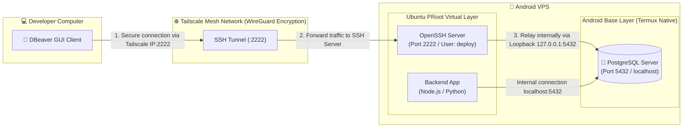

# PostgreSQL Installation & Database Management via DBeaver on Android VPS

[**[🇻🇳 Đọc bản Tiếng Việt](../vi/dbeaver-database-guide.md)** • **[🏠 Home](../../README.md)**]

This guide provides instructions for installing and running **PostgreSQL** natively on an Android VPS (Termux + Ubuntu PRoot) and managing databases graphically from your PC/laptop using **DBeaver** over a secure **SSH Tunnel** powered by **Tailscale**.

---

## 📑 Table of Contents

1. [Architecture Overview](#1-architecture-overview)
2. [Why Run PostgreSQL Native on Termux Instead of PRoot?](#2-why-run-postgresql-native-on-termux-instead-of-proot)
3. [Step 1: Install & Start PostgreSQL on Termux Host](#step-1-install--start-postgresql-on-termux-host)
4. [Step 2: Configure Superuser Password & Project Database](#step-2-configure-superuser-password--project-database)
5. [Step 3: Enable Autostart on Boot](#step-3-enable-autostart-on-boot)
6. [Step 4: Configure DBeaver via SSH Tunnel](#step-4-configure-dbeaver-via-ssh-tunnel)
7. [Step 5: Managing Multiple Databases in DBeaver](#step-5-managing-multiple-databases-in-dbeaver)
8. [Troubleshooting FAQ](#troubleshooting-faq)

---

## 1. Architecture Overview



### Key Advantages:
1. **Zero Public Exposure**: Port `5432` is **not open to the public internet**. DBeaver connects exclusively through an SSH tunnel authenticated and encrypted by Tailscale.
2. **Shared Local Loopback**: Both the backend services running inside Ubuntu PRoot and the DBeaver client on your PC access the same PostgreSQL cluster on `localhost:5432`.
3. **Ultra-Low Resource Footprint**: The entire PostgreSQL server uses only ~30 MB physical RAM, running 24/7 without degrading phone performance.

---

## 2. Why Run PostgreSQL Native on Termux Instead of PRoot?

> [!IMPORTANT]
> **PostgreSQL Deadlock Issue Inside PRoot:**
> Standard Ubuntu PostgreSQL packages are built for Linux kernel environments with complete System V shared memory support (`SysV IPC` / `shmget` / `shared_buffers`). The Android Linux kernel restricts these low-level IPC probes, causing PRoot's user-space virtualization layer to fall into an unrecoverable deadlock during `initdb`, freezing the entire system.

**The Solution:**
Install the official PostgreSQL package on **Termux Native** (`pkg install postgresql`). This package has been specially patched for the Android Bionic C runtime:
* Database initialization (`initdb`) completes in **under 2 seconds**.
* No permission or shared memory errors.
* Port `5432` is automatically shared with Ubuntu PRoot via the OS loopback interface.

---

## 3. Step 1: Install & Start PostgreSQL on Termux Host

Perform this step directly in the Termux main terminal (`~$`, **outside Ubuntu PRoot**):

```bash
# 1. Update Termux repositories
pkg update -y

# 2. Install Android-optimized PostgreSQL package
pkg install postgresql -y

# 3. Create data directory & initialize database cluster
mkdir -p $PREFIX/var/lib/postgresql
initdb $PREFIX/var/lib/postgresql

# 4. Start PostgreSQL daemon
pg_ctl -D $PREFIX/var/lib/postgresql -l logfile start
```

Verify service status:
```bash
pg_isready
```
*Expected output: `/data/data/com.termux/files/usr/tmp:5432 - accepting connections` confirming the database engine is live.*

---

## 4. Step 2: Configure Superuser Password & Project Database

By default, Termux creates a cluster role matching your Termux username with no password. Configure the standard `postgres` user and create your database:

In Termux terminal:
```bash
psql -d postgres
```

Inside the interactive `postgres=#` prompt:

```sql
-- 1. Set password for the postgres administrator account:
ALTER USER postgres WITH PASSWORD '123123';

-- (If the role "postgres" does not exist, create it with):
-- CREATE ROLE postgres WITH SUPERUSER LOGIN PASSWORD '123123';

-- 2. Create database for your project:
CREATE DATABASE myapp_db;

-- 3. Grant privileges:
GRANT ALL PRIVILEGES ON DATABASE myapp_db TO postgres;

-- 4. Exit psql:
\q
```

---

## 5. Step 3: Enable Autostart on Boot

To automatically start PostgreSQL whenever Termux opens or after phone reboots:

Edit Termux's startup file:
```bash
nano ~/.bashrc
```

Add this block at the top:
```bash
# Start PostgreSQL if not already running
if ! pg_isready -q; then
    pg_ctl -D $PREFIX/var/lib/postgresql -l logfile start
fi
```
Press `Ctrl + O` → `Enter` to save, `Ctrl + X` to exit.

---

## 6. Step 4: Configure DBeaver via SSH Tunnel

Install [DBeaver Community Edition](https://dbeaver.io/) on your PC (Windows, macOS, Linux).

### 6.1. Create a New Connection
1. Launch DBeaver.
2. Click **New Database Connection** (plug icon with green `+`).
3. Select **PostgreSQL** → Click **Next**.

---

### 6.2. Main Tab (Database Configuration)

Fill in the database connection details:

| Field | Value | Notes |
| :--- | :--- | :--- |
| **Host** | `localhost` *(or `127.0.0.1`)* | **Must be `localhost`**. Evaluated from the remote end of the SSH tunnel inside the phone. |
| **Port** | `5432` | Standard PostgreSQL port. |
| **Database** | `myapp_db` *(or `postgres`)* | The database name created in Step 2. |
| **Username** | `postgres` | Database superuser account. |
| **Password** | `123123` *(or your custom password)* | Configured in Step 2. |

---

### 6.3. SSH Tab (Encrypted Tunnel via Tailscale)

Switch to the **SSH** tab and check **`[x] Use SSH Tunnel`**:

| Field | Value | Notes |
| :--- | :--- | :--- |
| **Host/IP** | `100.94.18.108` *(Phone Tailscale IP)* | Tailscale IP of your Android VPS. |
| **Port** | `2222` | Ubuntu PRoot SSH port (or `8022` for Termux host). |
| **User Name** | `deploy` | SSH user account on Ubuntu. |
| **Authentication Method** | **Password** or **Public Key** | Your SSH credential method: |
| ↳ *If Password* | Enter password for `deploy` | Ubuntu user login password. |
| ↳ *If Public Key* | Path to PC private key | e.g. `C:\Users\Admin\.ssh\id_ed25519` or `~/.ssh/id_ed25519`. |

---

### 6.4. Test & Finish Connection
1. Click **Test Connection** in the bottom-left corner.
   * *If prompted to download the PostgreSQL driver, click **Download** (takes a few seconds).*
2. A green checkmark dialog will appear:
   ```text
   Connected
   PostgreSQL 17.x (or 16.x)
   Connection test successful
   ```
3. Click **Finish**. You can now browse tables, schemas, execute queries, and modify records via GUI.

---

## 7. Step 5: Managing Multiple Databases in DBeaver

You can host and manage dozens of project databases on this single PostgreSQL cluster:

### 7.1. Create a New Database for Another Project
1. In DBeaver's left tree view, expand your connection.
2. Right-click **Databases** → select **Create New Database**.
3. Input the new database name (e.g. `ecommerce_db`, `auth_service_db`) → set Owner to `postgres` → click **OK**.

### 7.2. SQL Editor
* Press `Ctrl + ]` (or `F3`) to open an interactive SQL query script.
* Run migrations, data exports, table modifications, or inspection queries directly.

---

## 8. Troubleshooting FAQ

### 8.1. `Error establishing SSHJ tunnel: Connect timed out`
* **Root Cause**: The PC cannot reach the phone's Tailscale IP (`100.x.y.z`). Occurs when Android sleeps and puts Tailscale into background doze mode.
* **Resolution**:
  1. Wake the phone screen; confirm the Tailscale VPN key icon is active in the status bar.
  2. Test connectivity from PC terminal: `tailscale ping 100.x.y.z`.
  3. Ensure 24/7 persistence: In **Android Settings** → **Network & Internet** → **VPN** → Tap gear next to Tailscale → Enable **Always-on VPN**.

### 8.2. `Connection refused on port 5432`
* **Root Cause**: The SSH tunnel connected successfully, but PostgreSQL daemon is not active on Termux host.
* **Resolution**:
  1. Open Termux (or SSH to port `8022`).
  2. Run:
     ```bash
     pg_ctl -D $PREFIX/var/lib/postgresql -l logfile start
     ```
  3. Verify with `pg_isready`.

### 8.3. `FATAL: password authentication failed for user "postgres"`
* **Root Cause**: Password mismatch in DBeaver Main tab.
* **Resolution**:
  1. In Termux, open `psql -d postgres`.
  2. Reset password:
     ```sql
     ALTER USER postgres WITH PASSWORD 'your_new_password';
     \q
     ```
  3. Update password field in DBeaver Main tab.

### 8.4. `Host key verification failed` in SSH Tab
* **Root Cause**: Ubuntu PRoot was reinstalled or regenerated new SSH Host keys.
* **Resolution**:
  * In DBeaver: Go to **SSH** tab → Click **Advanced** → Uncheck **Verify Host Key** (or remove outdated entry from `~/.ssh/known_hosts` on your PC).
