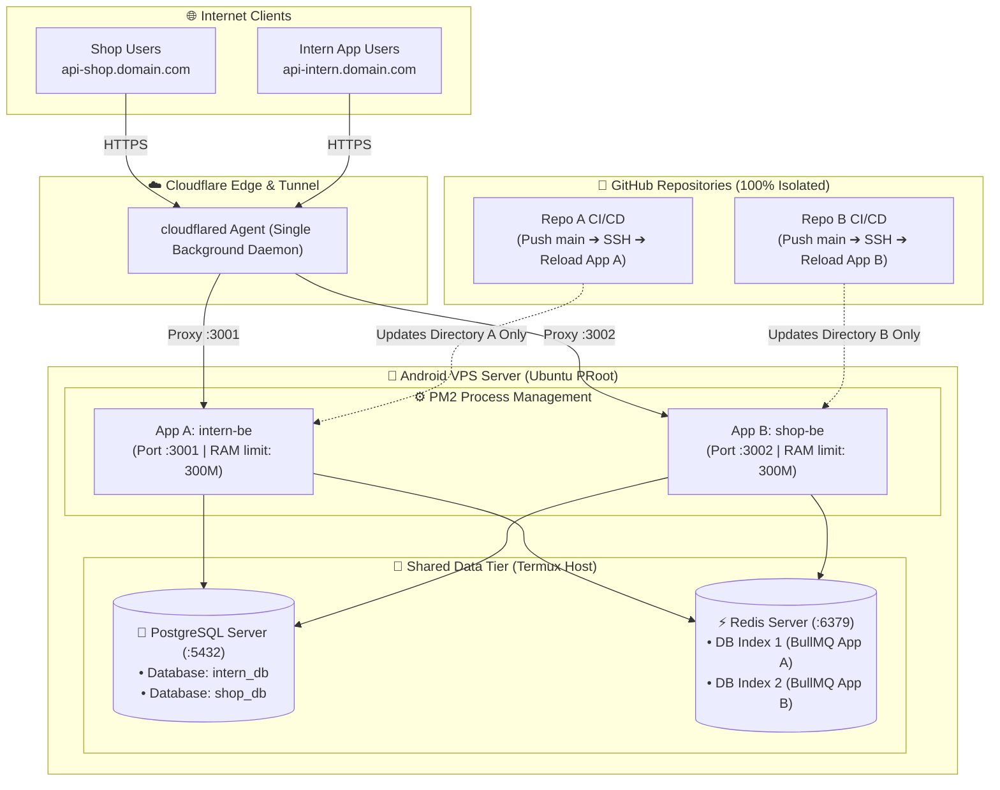

# Multi-Backend Service Management & Isolated CI/CD on Android VPS

[**[🇻🇳 Đọc bản Tiếng Việt](../vi/multi-backend-management.md)** • **[🏠 Home](../../README.md)**]

This guide provides architectural patterns and operational procedures for hosting and managing **multiple Backend services** (Node.js, NestJS, Express, Python FastAPI, Go, etc.) simultaneously on a single Android VPS (Termux + Ubuntu PRoot), ensuring **independent CI/CD pipelines, zero resource contention, and zero cross-project downtime**.

---

## 📑 Table of Contents

1. [Challenges of Multi-Backend Hosting on Android VPS](#1-challenges-of-multi-backend-hosting-on-android-vps)
2. [The "4 Pillars of Isolation" Architecture](#2-the-4-pillars-of-isolation-architecture)
3. [Pillar 1: Directory, Port & Resource Allocation](#3-pillar-1-directory-port--resource-allocation)
4. [Pillar 2: Process Isolation with PM2](#4-pillar-2-process-isolation-with-pm2)
5. [Pillar 3: Independent GitHub Actions CI/CD Pipelines](#5-pillar-3-independent-github-actions-cicd-pipelines)
6. [Pillar 4: Multi-Subdomain Ingress Routing with Cloudflare Tunnel](#6-pillar-4-multi-subdomain-ingress-routing-with-cloudflare-tunnel)
7. [The "3 Do-Nots" Rulebook for System Stability](#7-the-3-do-nots-rulebook-for-system-stability)
8. [Resource Monitoring & Memory Optimization](#8-resource-monitoring--memory-optimization)

---

## 1. Challenges of Multi-Backend Hosting on Android VPS

On standard cloud platforms (AWS, DigitalOcean), multi-service isolation is typically achieved via Docker containers with isolated virtual networks and cgroups.

However, on an Android VPS:
* The **PRoot** virtualization layer operates in user space via `ptrace` and **lacks permission to interact with Linux kernel cgroups and namespaces to run Docker daemon**.
* Physical resources are constrained (ARM Helio/Snapdragon SoC, 3 GB - 4 GB RAM).
* All internal services share the host loopback network (`localhost`).

👉 **Goal**: Achieve enterprise-grade process isolation, port management, and zero-downtime CI/CD **without Docker**, ensuring deployments to Project A never impact Project B or C.

---

## 2. The "4 Pillars of Isolation" Architecture



---

## 3. Pillar 1: Directory, Port & Resource Allocation

Fundamental Rule: **Every project must have a distinct, non-overlapping set of identifiers**.

### 3.1. Standard Resource Allocation Matrix

| Project | Working Directory | App Port (`APP_PORT`) | PostgreSQL Database | Redis Queue (`QUEUE_REDIS_URL`) | PM2 Process Name |
| :--- | :--- | :---: | :--- | :--- | :--- |
| **Project A** (`project-intern-be`) | `~/projects/project-intern-be` | **`3001`** | `intern_db` | `redis://localhost:6379/1` | `intern-be` |
| **Project B** (`ecommerce-api`) | `~/projects/ecommerce-api` | **`3002`** | `ecommerce_db` | `redis://localhost:6379/2` | `ecommerce-be` |
| **Project C** (`notification-svc`) | `~/projects/notification-svc` | **`3003`** | `notify_db` | `redis://localhost:6379/3` | `notify-be` |

### 3.2. Multi-Database Architecture on Single PostgreSQL Instance
* Run only **one native PostgreSQL instance** on Termux (`localhost:5432`), consuming only ~30 MB RAM.
* Create a dedicated database for each project:
  ```bash
  psql -U postgres -d postgres -c "CREATE DATABASE intern_db;"
  psql -U postgres -d postgres -c "CREATE DATABASE ecommerce_db;"
  ```
* Tables, schemas, and migrations remain completely isolated per database.

### 3.3. BullMQ Queue Separation via Redis Logical Databases
* Run a single `redis-server` instance on port `6379`.
* Redis supports 16 numbered logical databases (`0` to `15`).
* Specify different DB indices in the `.env` file of each backend:
  * Project A: `QUEUE_REDIS_URL=redis://localhost:6379/1`
  * Project B: `QUEUE_REDIS_URL=redis://localhost:6379/2`
* **Benefit**: Multiple BullMQ queues operate concurrently without key collision or cross-job consumption.

---

## 4. Pillar 2: Process Isolation with PM2

**PM2** provides enterprise-grade daemon management, health monitoring, zero-downtime reloads, and automatic crash recovery without container overhead.

### 4.1. Launch Each Backend with Explicit Identifiers

Inside each project's directory:

```bash
# Start Project A:
cd ~/projects/project-intern-be
pm2 start dist/main.js --name "intern-be" --max-memory-restart 300M

# Start Project B:
cd ~/projects/ecommerce-api
pm2 start dist/index.js --name "ecommerce-be" --max-memory-restart 300M
```

> [!IMPORTANT]
> **Why `--max-memory-restart 300M` is Essential:**
> Node.js defaults to a 1.4 GB memory heap ceiling. A memory leak in one backend could exhaust physical device RAM and trigger the Android low-memory killer (LMK). Setting a 300 MB limit ensures PM2 safely restarts that specific application without affecting the host or other running backends.

### 4.2. Persist State Across System Reboots

Once all services are started and verified:
```bash
pm2 save
```
This dumps the running process list to `~/.pm2/dump.pm2`. On cold boot, Ubuntu executes `pm2 resurrect` to instantly restore all backends.

### 4.3. Individual Process Operations

* Check all running services:
  ```bash
  pm2 list
  ```
* Stream logs for a single service:
  ```bash
  pm2 logs intern-be
  ```
* Perform zero-downtime reload for one service:
  ```bash
  pm2 reload intern-be --update-env
  ```

---

## 5. Pillar 3: Independent GitHub Actions CI/CD Pipelines

Each GitHub repository maintains its own `.github/workflows/deploy.yml` pipeline.

### 5.1. Workflow Template for Project A (`project-intern-be`)

In Project A's repository, create `.github/workflows/deploy.yml`:

```yaml
name: Deploy Project A (Intern Backend)

on:
  push:
    branches: [ "main" ]

jobs:
  deploy:
    runs-on: ubuntu-latest
    steps:
      - name: Connect to Tailscale Network
        uses: tailscale/github-action@v3
        with:
          authkey: ${{ secrets.TAILSCALE_AUTHKEY }}

      - name: Deploy Isolated Application via SSH
        uses: appleboy/ssh-action@v1.0.3
        with:
          host: ${{ secrets.SSH_HOST }}
          port: ${{ secrets.SSH_PORT }}
          username: ${{ secrets.SSH_USER }}
          key: ${{ secrets.SSH_PRIVATE_KEY }}
          script: |
            # 1. Scope strictly to Project A's directory
            cd ~/projects/project-intern-be || exit 1

            # 2. Pull latest release
            git pull origin main

            # 3. Install production dependencies & compile
            npm install --omit=dev
            npm run build

            # 4. Run database migration on intern_db
            npx prisma migrate deploy

            # 5. Reload ONLY the intern-be process (Zero Downtime)
            pm2 reload intern-be --update-env || pm2 start dist/main.js --name "intern-be" --max-memory-restart 300M
```

### 5.2. Workflow Template for Project B (`ecommerce-api`)

Project B uses the exact same workflow structure, modifying only:
* Target Directory: `cd ~/projects/ecommerce-api`
* PM2 Process Target: `pm2 reload ecommerce-be --update-env`

### 5.3. Why Cross-Interference is Mathematically Eliminated
1. **Directory Confinement**: `cd ~/projects/<app-folder>` isolates all `git pull`, `npm install`, and `.env` file modifications.
2. **Process Scoping**: `pm2 reload <app-name>` only triggers cluster rolling restarts on target worker threads.
3. **Database Segregation**: Migrations apply strictly against the scoped database instance (`intern_db` vs `ecommerce_db`).

---

## 6. Pillar 4: Multi-Subdomain Ingress Routing with Cloudflare Tunnel

There is **no need to configure complex Nginx reverse proxies**. A single background `cloudflared` daemon can route unlimited subdomains to distinct local ports.

### Configuration on Cloudflare Zero Trust Dashboard:

1. Navigate to [Cloudflare Zero Trust](https://one.dash.cloudflare.com/) ➔ **Networks** ➔ **Tunnels**.
2. Select your VPS Tunnel (e.g., `pocket-vps`) ➔ Click **Configure**.
3. Select the **Public Hostname** tab ➔ Click **Add a public hostname**:

#### Rule for Project A:
* **Subdomain**: `api-intern`
* **Domain**: `manhhuy.io.vn`
* **Service**: `HTTP`
* **URL**: `localhost:3001`
➔ Click **Save hostname**.

#### Rule for Project B:
* **Subdomain**: `api-shop`
* **Domain**: `manhhuy.io.vn`
* **Service**: `HTTP`
* **URL**: `localhost:3002`
➔ Click **Save hostname**.

Cloudflare Edge provides automated SSL termination, DDoS protection, and routes HTTP/WebSocket traffic directly to each internal port.

---

## 7. The "3 Do-Nots" Rulebook for System Stability

| Prohibited Action | Severity & Consequence | Recommended Practice |
| :--- | :--- | :--- |
| ❌ **Executing `pm2 reload all`** or `killall node` in CI/CD scripts | Causes simultaneous connection drops across all running production backends. | **Target specific application by name**: `pm2 reload intern-be --update-env`. |
| ❌ **Overlapping Ports or Redis DB Indices** | Subsequent applications fail to start with `EADDRINUSE`, or BullMQ workers cross-consume jobs. | Strictly follow the port allocation matrix (`3001`, `3002`, `3003`...) and Redis DB indices (`/1`, `/2`, `/3`...). |
| ❌ **Executing heavy builds/compilations directly on VPS** | Saturates ARM CPU and exhausts RAM, triggering Android system-level task termination. | Perform heavy builds and Docker packaging on GitHub Actions Cloud Runners; run lightweight compilation on the phone. |

---

## 8. Resource Monitoring & Memory Optimization

On a 4 GB RAM phone (e.g., Sony Xperia Ace II SO-41B):
* Android OS + Termux Base: ~1.2 GB RAM
* PostgreSQL + Redis Daemons: ~60 MB RAM
* Node.js/NestJS Worker (per instance): ~80 MB - 150 MB RAM
👉 The VPS comfortably supports **4 to 6 production backends concurrently**.

### Health Inspection Commands:

```bash
# 1. Real-time visual terminal dashboard:
pm2 monit

# 2. Inspect overall system memory utilization:
free -h

# 3. Identify top memory-consuming processes:
ps aux --sort=-%mem | head -n 10
```
