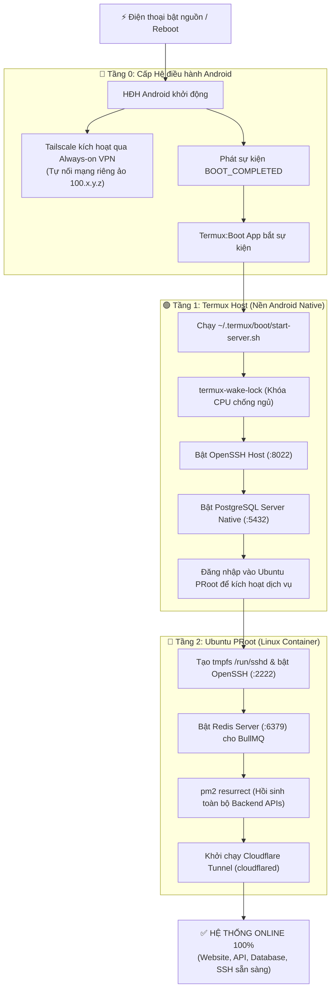

# Hướng Dẫn Tự Khởi Động Toàn Bộ Dịch Vụ Khi Điện Thoại Khởi Động Lại (Cold Reboot)

[**[🇬🇧 Read English Version](../en/autostart-services-guide.md)** • **[🏠 Trang chủ](../../README.vi.md)**]

Tài liệu này hướng dẫn chi tiết cách thiết lập cơ chế **tự phục hồi hoàn toàn tự động 100% (Unattended Autonomous Autostart)** cho máy chủ Android VPS. Khi điện thoại hết pin sập nguồn, khởi động lại, hoặc bị mất điện, toàn bộ hệ thống gồm **Tailscale**, **Termux SSH**, **PostgreSQL**, **Ubuntu SSH**, **Redis**, **PM2 Backends** và **Cloudflare Tunnel** sẽ tự động kích hoạt trở lại trong 30–45 giây mà **không cần con người chạm vào điện thoại**.

---

## 📑 Mục lục

1. [Chuỗi khởi động tự động (Cold Boot Sequence Architecture)](#1-chuỗi-khởi-động-tự-động-cold-boot-sequence-architecture)
2. [Tầng 0: Cấu hình Hệ điều hành Android chống tắt ngầm](#2-tầng-0-cấu-hình-hệ-điều-hành-android-chống-tắt-ngầm)
3. [Tầng 1: Cấu hình Script khởi động Termux:Boot (`start-server.sh`)](#3-tầng-1-cấu-hình-script-khởi-động-termuxboot-start-serversh)
4. [Tầng 2: Cấu hình Script điều phối dịch vụ trong Ubuntu (`start-services.sh`)](#4-tầng-2-cấu-hình-script-điều-phối-dịch-vụ-trong-ubuntu-start-servicessh)
5. [Tầng 3: Đồng bộ lưu trạng thái tiến trình PM2](#5-tầng-3-đồng-bộ-lưu-trạng-thái-tiến-trình-pm2)
6. [Quy trình Thử nghiệm thực tế Cold Reboot](#6-quy-trình-thử-nghiệm-thực-tế-cold-reboot)
7. [Cẩm nang xử lý sự cố khi Autostart không chạy (Troubleshooting FAQ)](#7-cẩm-nang-xử-lý-sự-cố-khi-autostart-không-chạy-troubleshooting-faq)

---

## 1. Chuỗi khởi động tự động (Cold Boot Sequence Architecture)



---

## 2. Tầng 0: Cấu hình Hệ điều hành Android chống tắt ngầm

Để Android không can thiệp tắt các tiến trình máy chủ, bạn cần cài đặt 3 thiết lập bắt buộc sau:

### 2.1. Cài đặt App phụ trợ `Termux:Boot`
1. Tải và cài đặt ứng dụng **Termux:Boot** từ **[F-Droid](https://f-droid.org/packages/com.termux.boot/)** hoặc **[GitHub Releases](https://github.com/termux/termux-boot/releases)**.
   *(Lưu ý: Bắt buộc nguồn cài của Termux và Termux:Boot phải cùng một nơi, ví dụ cùng tải từ F-Droid để tránh lỗi chữ ký số).*
2. Mở ứng dụng **Termux:Boot** một lần duy nhất từ màn hình chính để cấp quyền chạy khi khởi động (`RECEIVE_BOOT_COMPLETED`).

### 2.2. Tắt hoàn toàn Tối ưu hóa Pin (Battery Optimization)
Vào **Cài đặt Android** ➔ **Ứng dụng** ➔ chuyển quyền quản lý pin cho 3 ứng dụng sau thành **Không hạn chế (Unrestricted / Not Optimized)**:
* **Termux**
* **Termux:Boot**
* **Tailscale**

### 2.3. Bật chế độ "VPN luôn bật" (Always-on VPN) cho Tailscale
1. Vào **Cài đặt** ➔ **Mạng & Internet** (hoặc **Kết nối**) ➔ **VPN**.
2. Nhấn vào biểu tượng **bánh răng** cạnh ứng dụng **Tailscale**.
3. Bật tùy chọn **VPN luôn bật (Always-on VPN)**.
   *(Tính năng này đảm bảo ngay khi điện thoại khởi động xong phần cứng mạng, Tailscale sẽ tự động kết nối lại Tailnet mà không cần người dùng mở ứng dụng).*

---

## 3. Tầng 1: Cấu hình Script khởi động Termux:Boot (`start-server.sh`)

Mỗi khi máy khởi động, ứng dụng `Termux:Boot` sẽ tự động quét và chạy tất cả các script có quyền thực thi trong thư mục `~/.termux/boot/`.

Thực hiện ngay tại màn hình Termux (dấu nhắc `~$`, **ngoài môi trường Ubuntu**):

### 3.1. Tạo thư mục boot và file kịch bản
```bash
mkdir -p ~/.termux/boot
nano ~/.termux/boot/start-server.sh
```

### 3.2. Nội dung file `~/.termux/boot/start-server.sh`
```bash
#!/data/data/com.termux/files/usr/bin/bash
# ==============================================================================
# Termux:Boot Master Startup Script for Android VPS
# ==============================================================================

LOG_FILE="$HOME/boot.log"
echo "==================================================" >> "$LOG_FILE"
echo "[$(date '+%Y-%m-%d %H:%M:%S')] Phone Cold Boot detected." >> "$LOG_FILE"

# 1. Khóa CPU chống ngủ sâu (Sleep/Doze) khi màn hình tắt
termux-wake-lock
echo "[$(date '+%Y-%m-%d %H:%M:%S')] CPU Wake-lock acquired." >> "$LOG_FILE"

# 2. Chờ 10 giây để mạng Wi-Fi/4G và Tailscale ổn định
sleep 10

# 3. Kích hoạt SSH Server Termux Host (Cổng 8022 - Cổng cứu hộ)
if ! pgrep -x sshd > /dev/null 2>&1; then
    sshd
    echo "[$(date '+%Y-%m-%d %H:%M:%S')] Termux OpenSSH started on port 8022." >> "$LOG_FILE"
else
    echo "[$(date '+%Y-%m-%d %H:%M:%S')] Termux OpenSSH already running." >> "$LOG_FILE"
fi

# 4. Kích hoạt PostgreSQL Server Native (Cổng 5432)
if ! pg_isready -q > /dev/null 2>&1; then
    pg_ctl -D $PREFIX/var/lib/postgresql -l $PREFIX/var/lib/postgresql/logfile start
    echo "[$(date '+%Y-%m-%d %H:%M:%S')] PostgreSQL Native started on port 5432." >> "$LOG_FILE"
else
    echo "[$(date '+%Y-%m-%d %H:%M:%S')] PostgreSQL Native already running." >> "$LOG_FILE"
fi

# 5. Kích hoạt toàn bộ dịch vụ bên trong Ubuntu PRoot
# Thay 'deploy' bằng tên tài khoản Ubuntu của bạn nếu dùng tên khác
USERNAME="deploy"
UBUNTU_SCRIPT="/home/$USERNAME/scripts/start-services.sh"

if [ -f "$PREFIX/var/lib/proot-distro/installed-rootfs/ubuntu$UBUNTU_SCRIPT" ]; then
    echo "[$(date '+%Y-%m-%d %H:%M:%S')] Launching Ubuntu PRoot services as user: $USERNAME..." >> "$LOG_FILE"
    proot-distro login ubuntu -- su - "$USERNAME" -c "$UBUNTU_SCRIPT start" >> "$LOG_FILE" 2>&1
    echo "[$(date '+%Y-%m-%d %H:%M:%S')] Ubuntu PRoot services launched successfully." >> "$LOG_FILE"
else
    echo "[$(date '+%Y-%m-%d %H:%M:%S')] ERROR: Ubuntu script not found at $UBUNTU_SCRIPT" >> "$LOG_FILE"
fi

echo "[$(date '+%Y-%m-%d %H:%M:%S')] Master boot sequence finished." >> "$LOG_FILE"
```

### 3.3. Cấp quyền thực thi cho script
```bash
chmod +x ~/.termux/boot/start-server.sh
```

---

### 3.4. Phương án thay thế: Tự động chạy toàn bộ dịch vụ khi mở App Termux thủ công (`~/.bashrc`)

Nếu bạn không muốn phụ thuộc vào app `Termux:Boot` mà muốn **chỉ cần chạm mở app Termux trên điện thoại là toàn bộ hệ thống VPS tự động bật lên**:

Thêm đoạn script sau vào file `~/.bashrc` trên Termux (ngoài môi trường Ubuntu):

```bash
cat << 'EOF' >> ~/.bashrc

# ==============================================================================
# Auto-start VPS Services when opening Termux manually
# ==============================================================================
if ! pgrep -x sshd > /dev/null 2>&1; then
    echo "=============================================="
    echo "🚀 Đang khởi động toàn bộ dịch vụ VPS..."
    echo "=============================================="
    termux-wake-lock
    sshd
    echo "✅ [Termux] SSH (Port 8022): OK"

    if ! pg_isready -q > /dev/null 2>&1; then
        pg_ctl -D $PREFIX/var/lib/postgresql -l $PREFIX/var/lib/postgresql/logfile start > /dev/null 2>&1
        echo "✅ [Termux] PostgreSQL (Port 5432): OK"
    fi

    echo "⏳ [Ubuntu] Đang bật SSH 2222, Redis, PM2, Cloudflare Tunnel..."
    proot-distro login ubuntu --user deploy -- bash -l -c "/home/deploy/scripts/start-services.sh"
    echo "=============================================="
    echo "🎉 Toàn bộ dịch vụ VPS đã sẵn sàng!"
    echo "=============================================="
fi
alias vps="proot-distro login ubuntu --user deploy"
EOF
```

*Cơ chế hoạt động*:
* Lần đầu bạn mở Termux sau khi bật máy: Do `sshd` chưa chạy, script sẽ tự động kích hoạt CPU Wake-lock, Postgres, và toàn bộ dịch vụ trong Ubuntu.
* Khi bạn mở thêm tab/phiên mới: Do `sshd` đã chạy, Termux sẽ bỏ qua và mở dấu nhắc lệnh ngay lập tức mà không chạy lại dịch vụ.
* Gõ `vps` để đăng nhập nhanh vào tài khoản `deploy` trong Ubuntu PRoot bất cứ lúc nào.

---

## 4. Tầng 2: Cấu hình Script điều phối dịch vụ trong Ubuntu (`start-services.sh`)

Đăng nhập vào Ubuntu (`proot-distro login ubuntu --user deploy` hoặc SSH cổng `2222`):

### 4.1. Tạo thư mục script và file thực thi
```bash
mkdir -p ~/scripts ~/logs
nano ~/scripts/start-services.sh
```

### 4.2. Nội dung file `~/scripts/start-services.sh`
```bash
#!/bin/bash
# ==============================================================================
# Ubuntu PRoot Unified Service Manager
# Usage: ~/scripts/start-services.sh [start|stop|restart|status]
# ==============================================================================

LOG_DIR="$HOME/logs"
mkdir -p "$LOG_DIR"

start_all() {
    echo "=== [$(date '+%Y-%m-%d %H:%M:%S')] Starting Ubuntu VPS Services ==="

    # 1. Khởi động OpenSSH Server (Cổng 2222)
    sudo mkdir -p /run/sshd
    sudo chmod 0755 /run/sshd
    if ! ss -lnt | grep -q ":2222 "; then
        sudo service ssh start
        echo "[SSH] OpenSSH server started on port 2222."
    else
        echo "[SSH] OpenSSH server already active."
    fi

    # 2. Khởi động Redis Server (Cổng 6379 - Cho BullMQ)
    if ! ss -lnt | grep -q ":6379 "; then
        sudo service redis-server start
        echo "[Redis] redis-server started on port 6379."
    else
        echo "[Redis] redis-server already active."
    fi

    # 3. Phục hồi toàn bộ các ứng dụng Backend qua PM2
    if command -v pm2 > /dev/null 2>&1; then
        echo "[PM2] Resurrecting saved applications..."
        pm2 resurrect > /dev/null 2>&1 || true
        echo "[PM2] Applications restored."
    fi

    # 4. Khởi động Cloudflare Tunnel (Định tuyến tên miền)
    if ! pidof cloudflared > /dev/null 2>&1; then
        TOKEN_FILE="$HOME/.cloudflared/token"
        if [ -f "$TOKEN_FILE" ]; then
            TOKEN=$(cat "$TOKEN_FILE" | tr -d '\n\r')
            nohup cloudflared tunnel run --token "$TOKEN" > "$LOG_DIR/cloudflared.log" 2>&1 < /dev/null &
            echo "[Cloudflare] Tunnel started in background."
        elif [ -f "$HOME/start-tunnel.sh" ]; then
            bash "$HOME/start-tunnel.sh" > /dev/null 2>&1 &
            echo "[Cloudflare] Tunnel script executed."
        else
            echo "[Cloudflare] WARN: Neither token file nor start-tunnel.sh found."
        fi
    else
        echo "[Cloudflare] cloudflared is already running."
    fi

    echo "=== Service initialization complete. ==="
}

stop_all() {
    echo "=== Stopping Ubuntu VPS Services ==="
    sudo service ssh stop > /dev/null 2>&1 && echo "[SSH] Stopped."
    sudo service redis-server stop > /dev/null 2>&1 && echo "[Redis] Stopped."
    killall cloudflared > /dev/null 2>&1 || pkill -9 cloudflared > /dev/null 2>&1 && echo "[Cloudflare] Stopped."
    pm2 stop all > /dev/null 2>&1 && echo "[PM2] Stopped all apps."
}

case "$1" in
    start)   start_all ;;
    stop)    stop_all ;;
    restart) stop_all; sleep 2; start_all ;;
    status)
        echo "=== VPS Service Health Check ==="
        echo "SSH (:2222):  $(ss -lnt | grep -q ':2222 ' && echo 'ONLINE' || echo 'OFFLINE')"
        echo "Redis (:6379): $(ss -lnt | grep -q ':6379 ' && echo 'ONLINE' || echo 'OFFLINE')"
        echo "Tunnel:        $(pidof cloudflared > /dev/null && echo 'ONLINE' || echo 'OFFLINE')"
        pm2 list
        ;;
    *)       start_all ;;
esac
```

### 4.3. Cấp quyền thực thi
```bash
chmod +x ~/scripts/start-services.sh
```

---

## 5. Tầng 3: Đồng bộ lưu trạng thái tiến trình PM2

Lệnh `pm2 resurrect` chỉ có thể phục hồi những ứng dụng đã được lưu lại trước đó. Mỗi khi bạn thêm mới hoặc cập nhật dự án Backend, hãy nhớ chạy lệnh sau:

```bash
# Sau khi khởi chạy các app:
pm2 start dist/main.js --name "intern-be" --max-memory-restart 300M

# LƯU LẠI VÀO BỘ NHỚ HỆ THỐNG:
pm2 save
```

Khi chạy lệnh này, danh sách ứng dụng, thư mục làm việc, biến môi trường và thiết lập RAM sẽ được lưu vĩnh viễn vào `~/.pm2/dump.pm2`.

---

## 6. Quy trình Thử nghiệm thực tế Cold Reboot

Để kiểm tra toàn bộ chuỗi tự khởi động đã hoạt động trơn tru:

1. **Bước 1**: Đảm bảo điện thoại đang cắm sạc nguồn.
2. **Bước 2**: Tắt nguồn điện thoại hoàn toàn (**Power Off** / Tắt nguồn, không chỉ là Restart).
3. **Bước 3**: Bật nguồn điện thoại lại và đặt điện thoại sang một bên (không cần mở khóa màn hình).
4. **Bước 4**: Chờ khoảng 30–45 giây.
5. **Bước 5**: Từ máy tính kiểm tra:
   ```bash
   # Kiểm tra mạng Tailscale thông suốt:
   tailscale ping 100.94.18.108

   # Kiểm tra SSH vào Ubuntu PRoot:
   ssh -p 2222 deploy@100.94.18.108

   # Kiểm tra SSH vào Termux Host:
   ssh -p 8022 100.94.18.108
   ```
6. **Bước 6**: Mở trình duyệt truy cập website của bạn qua tên miền Cloudflare (`https://app.yourdomain.com`).
   * *Nếu trang web phản hồi mượt mà và Database kết nối bình thường, hệ thống tự phục hồi 100% của bạn đã hoàn thành xuất sắc!*
7. **Bước 7**: Xem nhật ký khởi động chi tiết trên Termux:
   ```bash
   cat ~/boot.log
   ```

---

## 7. Cẩm nang xử lý sự cố khi Autostart không chạy (Troubleshooting FAQ)

### 7.1. Lỗi: Điện thoại khởi động lại nhưng Tailscale không nhận IP
* **Nguyên nhân**: Android chưa kịp kết nối Wi-Fi hoặc Tailscale bị hệ thống đóng băng.
* **Khắc phục**:
  1. Kiểm tra lại thiết lập **VPN luôn bật (Always-on VPN)** trong Cài đặt Android.
  2. Đảm bảo Wi-Fi ở chế độ "Tự động kết nối lại (Auto-reconnect)".

### 7.2. Lỗi: Termux:Boot không chạy sau khi khởi động
* **Nguyên nhân**: Một số hãng điện thoại (Xiaomi MIUI/HyperOS, Oppo ColorOS, Vivo Funtouch) mặc định chặn quyền "Tự khởi chạy (Autostart)" của ứng dụng bên thứ ba.
* **Khắc phục**:
  1. Vào **Cài đặt** ➔ **Quản lý ứng dụng** ➔ chọn **Termux** và **Termux:Boot**.
  2. Bật quyền **Tự khởi chạy (Autostart)** và **Chạy ngầm (Run in background)**.
  3. Mở ứng dụng **Termux:Boot** trực tiếp 1 lần bằng tay để hệ thống ghi nhớ.

### 7.3. Lưu ý về Cơ chế mã hóa File (Direct Boot / File-Based Encryption)
* Trên một số dòng máy Android 10+ có kích hoạt mã hóa màn hình khóa (FBE - File-Based Encryption), các app không được phép truy cập bộ nhớ bảo mật trước khi người dùng mở khóa màn hình lần đầu tiên (First Unlock).
* **Mẹo tối ưu cho máy chủ chuyên dụng 24/7**: Bạn có thể tắt màn hình khóa (chuyển sang chế độ **Không có mật khẩu / Vuốt để mở**). Khi mất điện có lại hoặc reboot, máy sẽ khởi động thẳng vào hệ thống mà không bị dừng chờ mật khẩu mở khóa màn hình.
