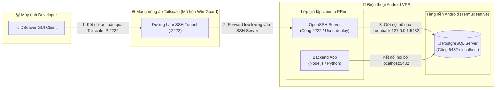

# Hướng Dẫn Cài Đặt PostgreSQL & Quản Trị Bằng DBeaver Trên Android VPS

[**[🇬🇧 Read English Version](../en/dbeaver-database-guide.md)** • **[🏠 Trang chủ](../../README.vi.md)**]

Tài liệu này hướng dẫn chi tiết cách cài đặt hệ quản trị cơ sở dữ liệu **PostgreSQL** chuẩn trên máy chủ Android VPS (Termux + Ubuntu PRoot) và kết nối quản trị trực quan từ máy tính bằng công cụ **DBeaver** thông qua đường hầm bảo mật **SSH Tunnel** qua mạng riêng ảo **Tailscale**.

---

## 📑 Mục lục

1. [Kiến trúc kết nối tổng quan](#1-kiến-trúc-kết-nối-tổng-quan)
2. [Tại sao chạy PostgreSQL Native trên Termux thay vì trong PRoot?](#2-tại-sao-chạy-postgresql-native-trên-termux-thay-vì-trong-proot)
3. [Bước 1: Cài đặt và khởi chạy PostgreSQL trên Termux Host](#bước-1-cài-đặt-và-khởi-chạy-postgresql-trên-termux-host)
4. [Bước 2: Tạo User, Mật khẩu và Cơ sở dữ liệu cho Dự án](#bước-2-tạo-user-mật-khẩu-và-cơ-sở-dữ-liệu-cho-dự-án)
5. [Bước 3: Cấu hình tự khởi động PostgreSQL khi mở máy](#bước-3-cấu-hình-tự-khởi-động-postgresql-khi-mở-máy)
6. [Bước 4: Cấu hình kết nối DBeaver từ Máy tính qua SSH Tunnel](#bước-4-cấu-hình-kết-nối-dbeaver-từ-máy-tính-qua-ssh-tunnel)
7. [Bước 5: Thao tác quản trị nhiều Database trên DBeaver](#bước-5-thao-tác-quản-trị-nhiều-database-trên-dbeaver)
8. [Cẩm nang xử lý sự cố thường gặp (Troubleshooting FAQ)](#cẩm-nang-xử-lý-sự-cố-thường-gặp-troubleshooting-faq)

---

## 1. Kiến trúc kết nối tổng quan



### Ưu điểm vượt trội của kiến trúc này:
1. **Bảo mật tuyệt đối**: Cổng cơ sở dữ liệu `5432` **không mở ra ngoài Internet**. DBeaver chỉ có thể truy cập thông qua SSH Tunnel đã được xác thực bảo mật và mã hóa bởi mạng riêng ảo Tailscale.
2. **Dùng chung tài nguyên nội bộ**: Cả ứng dụng Backend trong Ubuntu PRoot lẫn phần mềm quản trị DBeaver từ máy tính đều truy cập chung vào cụm dữ liệu tại `localhost:5432`.
3. **Tiết kiệm tài nguyên tối đa**: 1 cụm PostgreSQL chỉ tiêu tốn ~30MB RAM vật lý trên chip điện thoại, hoạt động ổn định 24/7.

---

## 2. Tại sao chạy PostgreSQL Native trên Termux thay vì trong PRoot?

> [!IMPORTANT]
> **Hiện tượng Deadlock của PostgreSQL trong PRoot:**
> Gói `postgresql` tiêu chuẩn của Ubuntu biên dịch cho Linux nhân chuẩn, khi khởi tạo cơ sở dữ liệu (`initdb`), nó thực hiện các kiểm tra thăm dò bộ nhớ chia sẻ sâu (`SysV IPC` / `shmget` / `shared_buffers`). Nhân hệ điều hành Android chặn các lời gọi này, khiến lớp ảo hóa cấp người dùng PRoot bị treo cứng (deadlock) vĩnh viễn và đóng băng toàn bộ hệ thống.

**Giải pháp tối ưu:**
Cài đặt gói `postgresql` trực tiếp trên **Termux Native** (`pkg install postgresql`). Gói này đã được cộng đồng Termux vá mã nguồn tương thích 100% với thư viện Android Bionic:
* Quá trình `initdb` hoàn thành **trong đúng 2 giây**.
* Không gặp bất kỳ lỗi xung đột quyền phân vùng hay bộ nhớ chia sẻ.
* Chia sẻ cổng `5432` trực tiếp với Ubuntu PRoot qua loopback interface chung của hệ điều hành.

---

## 3. Bước 1: Cài đặt và khởi chạy PostgreSQL trên Termux Host

Thực hiện ngay tại màn hình chính của Termux (dấu nhắc `~$`, **chưa đăng nhập vào Ubuntu**):

```bash
# 1. Cập nhật kho ứng dụng Termux
pkg update -y

# 2. Cài đặt gói PostgreSQL tối ưu cho Android
pkg install postgresql -y

# 3. Tạo thư mục chứa dữ liệu và khởi tạo cụm database
mkdir -p $PREFIX/var/lib/postgresql
initdb $PREFIX/var/lib/postgresql

# 4. Khởi động dịch vụ PostgreSQL nền
pg_ctl -D $PREFIX/var/lib/postgresql -l logfile start
```

Kiểm tra trạng thái máy chủ cơ sở dữ liệu:
```bash
pg_isready
```
*Kết quả hiển thị: `/data/data/com.termux/files/usr/tmp:5432 - accepting connections` nghĩa là máy chủ đã sẵn sàng 100%.*

---

## 4. Bước 2: Tạo User, Mật khẩu và Cơ sở dữ liệu cho Dự án

Mặc định Termux tạo tài khoản trùng với tên user của Termux (không có mật khẩu). Để DBeaver và Backend kết nối chuẩn mực, ta tạo user `postgres` và database dự án.

Tại terminal Termux, gõ:
```bash
psql -d postgres
```

Trong giao diện tương tác `postgres=#`, bạn chạy các lệnh SQL sau:

```sql
-- 1. Đặt mật khẩu cho tài khoản quản trị postgres (ví dụ đặt là 123123)
ALTER USER postgres WITH PASSWORD '123123';

-- (Nếu hệ thống báo role "postgres" does not exist, tạo mới bằng lệnh sau):
-- CREATE ROLE postgres WITH SUPERUSER LOGIN PASSWORD '123123';

-- 2. Tạo cơ sở dữ liệu dành riêng cho dự án
CREATE DATABASE myapp_db;

-- 3. Cấp toàn quyền trên database cho user postgres
GRANT ALL PRIVILEGES ON DATABASE myapp_db TO postgres;

-- 4. Thoát khỏi giao diện psql
\q
```

---

## 5. Bước 3: Cấu hình tự khởi động PostgreSQL khi mở máy

Để PostgreSQL tự động bật mỗi khi bạn mở ứng dụng Termux hoặc sau khi điện thoại khởi động lại:

Mở file cấu hình khởi động của Termux:
```bash
nano ~/.bashrc
```

Thêm khối lệnh sau vào đầu file:
```bash
# Tự động khởi chạy PostgreSQL nếu chưa bật
if ! pg_isready -q; then
    pg_ctl -D $PREFIX/var/lib/postgresql -l logfile start
fi
```
Nhấn `Ctrl + O` → `Enter` để lưu, `Ctrl + X` để thoát `nano`.

---

## 6. Bước 4: Cấu hình kết nối DBeaver từ Máy tính qua SSH Tunnel

Cài đặt [DBeaver Community Edition](https://dbeaver.io/) trên máy tính của bạn (hỗ trợ Windows, macOS, Linux).

### 6.1. Tạo kết nối mới
1. Mở DBeaver.
2. Nhấn vào biểu tượng **New Database Connection** (phích cắm có dấu `+` màu xanh ở góc trên bên trái).
3. Chọn loại cơ sở dữ liệu: **PostgreSQL** → Nhấn **Next**.

---

### 6.2. Cấu hình Tab "Main" (Thông tin Database)

Điền chính xác các thông tin cơ sở dữ liệu:

| Trường thông tin | Giá trị điền | Giải thích chi tiết |
| :--- | :--- | :--- |
| **Host** | `localhost` *(hoặc `127.0.0.1`)* | **Bắt buộc điền `localhost`**. DBeaver sau khi chui qua SSH Tunnel sẽ đứng ngay tại điện thoại để truy vấn nội bộ. |
| **Port** | `5432` | Cổng dịch vụ mặc định của PostgreSQL. |
| **Database** | `myapp_db` *(hoặc `postgres`)* | Tên cơ sở dữ liệu bạn đã tạo ở Bước 2. |
| **Username** | `postgres` | Tài khoản quản trị database. |
| **Password** | `123123` *(hoặc mật khẩu bạn đặt)* | Mật khẩu tài khoản `postgres` đã đặt ở Bước 2. |

---

### 6.3. Cấu hình Tab "SSH" (Đường hầm bảo mật qua Tailscale)

Chuyển sang tab **SSH** và tích chọn ô: **`[x] Use SSH Tunnel`**.

| Trường thông tin | Giá trị điền | Giải thích chi tiết |
| :--- | :--- | :--- |
| **Host/IP** | `100.94.18.108` *(IP Tailscale điện thoại)* | Địa chỉ IP Tailscale của máy chủ điện thoại. |
| **Port** | `2222` | Cổng SSH của Ubuntu PRoot (hoặc `8022` nếu SSH vào Termux Host). |
| **User Name** | `deploy` | Tên tài khoản người dùng SSH trên VPS Ubuntu. |
| **Authentication Method** | **Password** hoặc **Public Key** | Cách bạn đăng nhập SSH: |
| ↳ *Nếu chọn Password* | Nhập mật khẩu tài khoản `deploy` | Mật khẩu đăng nhập Ubuntu của user `deploy`. |
| ↳ *Nếu chọn Public Key* | Trỏ tới file Private Key trên máy tính | Ví dụ: `C:\Users\Admin\.ssh\id_ed25519` hoặc `~/.ssh/id_ed25519`. |

---

### 6.4. Kiểm tra kết nối và hoàn tất
1. Nhấn nút **Test Connection** ở góc dưới bên trái màn hình cấu hình.
   * *Nếu đây là lần đầu tiên kết nối PostgreSQL trên DBeaver, phần mềm sẽ hiển thị hộp thoại tải driver. Hãy bấm **Download** (quá trình mất khoảng vài giây).*
2. Khi màn hình hiển thị thông báo màu xanh lá:
   ```text
   Connected
   PostgreSQL 17.x (hoặc 16.x)
   Connection test successful
   ```
3. Nhấn **Finish** để lưu kết nối. Toàn bộ sơ đồ bảng, cột, khóa ngoại và dữ liệu sẽ hiển thị trên cây điều hướng bên trái.

---

## 7. Bước 5: Thao tác quản trị nhiều Database trên DBeaver

Trên một máy chủ PostgreSQL duy nhất này, bạn có thể tạo và quản lý độc lập hàng chục cơ sở dữ liệu cho nhiều dự án khác nhau:

### 7.1. Tạo thêm Database mới cho dự án khác
1. Trên cây điều hướng bên trái DBeaver, mở kết nối vừa tạo.
2. Nhấn chuột phải vào thư mục **Databases** → chọn **Create New Database**.
3. Nhập tên database mới (ví dụ: `ecommerce_db`, `auth_service_db`) → chọn Owner là `postgres` → nhấn **OK**.

### 7.2. Mở trình soạn thảo SQL (SQL Editor)
* Nhấn tổ hợp phím `Ctrl + ]` (hoặc `F3`) để mở cửa sổ soạn thảo truy vấn.
* Bạn có thể chạy migration, tạo bảng, chèn dữ liệu hoặc backup dump dữ liệu trực tiếp bằng giao diện đồ họa.

---

## 8. Cẩm nang xử lý sự cố thường gặp (Troubleshooting FAQ)

### 8.1. Lỗi: `Error establishing SSHJ tunnel: Connect timed out`
* **Nguyên nhân**: DBeaver từ máy tính không thể kết nối tới IP Tailscale của điện thoại (`100.x.y.z`). Thường xảy ra khi điện thoại tắt màn hình lâu khiến Android tự ngắt kết nối mạng của Tailscale.
* **Cách khắc phục**:
  1. Mở màn hình điện thoại, kiểm tra biểu tượng VPN Tailscale có đang sáng trên thanh trạng thái không.
  2. Trên máy tính, mở terminal kiểm tra kết nối: `tailscale ping 100.x.y.z`.
  3. Để duy trì kết nối 24/7 vĩnh viễn: Vào **Cài đặt Android** → **Mạng & Internet** → **VPN** → Bấm bánh răng cạnh Tailscale → Bật **VPN luôn bật (Always-on VPN)**.

### 8.2. Lỗi: `Connection refused on port 5432`
* **Nguyên nhân**: SSH Tunnel kết nối thành công vào điện thoại nhưng dịch vụ PostgreSQL ở tầng Termux chưa được khởi chạy.
* **Cách khắc phục**:
  1. Mở Termux trên điện thoại (hoặc SSH vào cổng `8022`).
  2. Chạy lệnh:
     ```bash
     pg_ctl -D $PREFIX/var/lib/postgresql -l logfile start
     ```
  3. Kiểm tra lại bằng lệnh `pg_isready`.

### 8.3. Lỗi: `FATAL: password authentication failed for user "postgres"`
* **Nguyên nhân**: Mật khẩu điền ở Tab Main không trùng khớp với mật khẩu tài khoản `postgres` trong cơ sở dữ liệu.
* **Cách khắc phục**:
  1. Vào Termux, mở công cụ dòng lệnh: `psql -d postgres`.
  2. Đặt lại mật khẩu mới:
     ```sql
     ALTER USER postgres WITH PASSWORD 'mat_khau_moi_cua_ban';
     \q
     ```
  3. Điền lại mật khẩu mới này vào ô **Password** ở Tab Main của DBeaver.

### 8.4. Lỗi: `Host key verification failed` ở Tab SSH
* **Nguyên nhân**: Máy chủ Ubuntu PRoot vừa được cài đặt lại hoặc sinh lại SSH Host Key mới, khiến DBeaver phát hiện sự thay đổi so với lần kết nối trước.
* **Cách khắc phục**:
  * Trong DBeaver: Tại tab **SSH** → Chọn mục **Advanced** → Bỏ tích chọn **Verify Host Key** (hoặc xóa dòng IP điện thoại trong file `known_hosts` trên máy tính của bạn).
