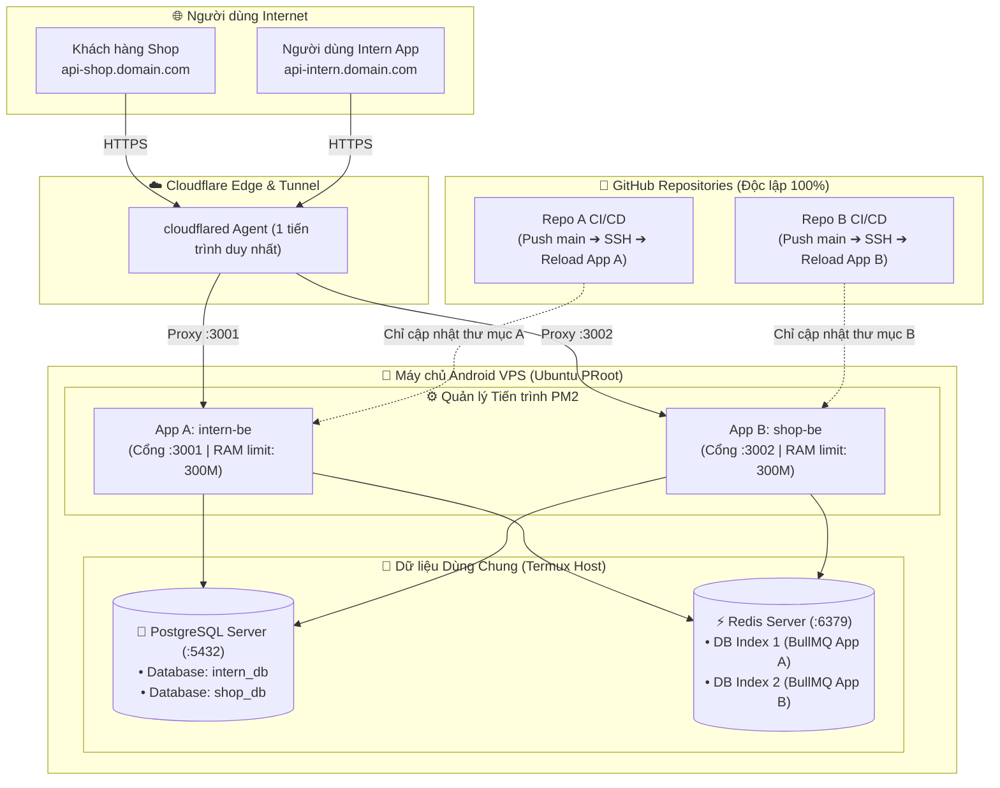

# Hướng Dẫn Quản Lý Nhiều Dự Án Backend & CI/CD Độc Lập Trên Android VPS

[**[🇬🇧 Read English Version](../en/multi-backend-management.md)** • **[🏠 Trang chủ](../../README.vi.md)**]

Tài liệu này hướng dẫn chi tiết cách vận hành và quản lý đồng thời **nhiều dự án Backend** (Node.js, NestJS, Express, Python FastAPI, Go...) trên cùng một máy chủ Android VPS (Termux + Ubuntu PRoot), đảm bảo quy trình **CI/CD giữa các dự án hoàn toàn độc lập, không xung đột tài nguyên và không làm gián đoạn lẫn nhau**.

---

## 📑 Mục lục

1. [Thách thức khi chạy Multi-Backend trên VPS Android](#1-thách-thức-khi-chạy-multi-backend-trên-vps-android)
2. [Mô hình kiến trúc "4 Trụ Cột Độc Lập"](#2-mô-hình-kiến-trúc-4-trụ-cột-độc-lập-4-pillars-of-isolation)
3. [Trụ cột 1: Phân bổ Thư mục, Cổng mạng (Port) & Tài nguyên](#3-trụ-cột-1-phân-bổ-thư-mục-cổng-mạng-port--tài-nguyên)
4. [Trụ cột 2: Quản lý tiến trình độc lập bằng PM2](#4-trụ-cột-2-quản-lý-tiến-trình-độc-lập-bằng-pm2)
5. [Trụ cột 3: Thiết lập Pipeline CI/CD GitHub Actions tách biệt từng Repo](#5-trụ-cột-3-thiết-lập-pipeline-cicd-github-actions-tách-biệt-từng-repo)
6. [Trụ cột 4: Định tuyến đa tên miền (Multi-Subdomain) với Cloudflare Tunnel](#6-trụ-cột-4-định-tuyến-đa-tên-miền-multi-subdomain-với-cloudflare-tunnel)
7. [Bảng quy tắc "3 KHÔNG" để tránh xung đột hệ thống](#7-bảng-quy-tắc-3-không-để-tránh-xung-đột-hệ-thống)
8. [Cẩm nang giám sát và Tối ưu hóa bộ nhớ RAM](#8-cẩm-nang-giám-sát-và-tối-ưu-hóa-bộ-nhớ-ram)

---

## 1. Thách thức khi chạy Multi-Backend trên VPS Android

Trên các máy chủ đám mây tiêu chuẩn (AWS, DigitalOcean), mỗi dự án thường được đóng gói trong một Docker Container riêng biệt với mạng và tài nguyên cô lập. 

Tuy nhiên, trên VPS Android:
* Lớp ảo hóa **PRoot** chạy trên không gian người dùng (`ptrace`), **không có quyền can thiệp vào kernel cgroups/namespaces để chạy Docker engine**.
* Tài nguyên phần cứng hữu hạn (chip ARM Helio/Snapdragon, RAM 3GB - 4GB).
* Tất cả các dịch vụ đều chia sẻ chung một mạng loopback nội bộ (`localhost`).

👉 **Mục tiêu**: Thiết lập cơ chế cô lập ứng dụng và tự động hóa CI/CD mà **không cần Docker**, đảm bảo dự án này `git push` hay restart không bao giờ làm chết dự án khác.

---

## 2. Mô hình kiến trúc "4 Trụ Cột Độc Lập" (4 Pillars of Isolation)



---

## 3. Trụ cột 1: Phân bổ Thư mục, Cổng mạng (Port) & Tài nguyên

Quy tắc nền tảng: **Mỗi dự án phải sở hữu một bộ thông số nhận diện độc nhất**.

### 3.1. Bảng phân bổ cấu hình mẫu

| Dự án | Thư mục làm việc | Cổng lắng nghe (`APP_PORT`) | Database PostgreSQL | Redis Queue (`QUEUE_REDIS_URL`) | Tên tiến trình PM2 |
| :--- | :--- | :---: | :--- | :--- | :--- |
| **Dự án A** (`project-intern-be`) | `~/projects/project-intern-be` | **`3001`** | `intern_db` | `redis://localhost:6379/1` | `intern-be` |
| **Dự án B** (`ecommerce-api`) | `~/projects/ecommerce-api` | **`3002`** | `ecommerce_db` | `redis://localhost:6379/2` | `ecommerce-be` |
| **Dự án C** (`notification-svc`) | `~/projects/notification-svc` | **`3003`** | `notify_db` | `redis://localhost:6379/3` | `notify-be` |

### 3.2. Quản lý PostgreSQL đa Database (Dùng chung 1 Server)
* Chỉ cần duy nhất 1 tiến trình PostgreSQL chạy ở Termux (`localhost:5432`) tiêu tốn ~30MB RAM.
* Mỗi dự án tạo riêng một cơ sở dữ liệu độc lập:
  ```bash
  psql -U postgres -d postgres -c "CREATE DATABASE intern_db;"
  psql -U postgres -d postgres -c "CREATE DATABASE ecommerce_db;"
  ```
* Dữ liệu, bảng, trigger của mỗi dự án được cô lập hoàn toàn trong cơ sở dữ liệu riêng của nó.

### 3.3. Phân chia hàng đợi BullMQ với Redis DB Index
* Dùng chung 1 dịch vụ `redis-server` chạy ở cổng `6379`.
* Redis mặc định hỗ trợ 16 cơ sở dữ liệu số (từ `0` đến `15`). 
* Cấu hình trong `.env` của từng dự án trỏ vào số DB khác nhau:
  * Dự án A: `QUEUE_REDIS_URL=redis://localhost:6379/1`
  * Dự án B: `QUEUE_REDIS_URL=redis://localhost:6379/2`
* **Lợi ích**: Hai ứng dụng cùng sử dụng BullMQ nhưng job, worker, audit log không bao giờ đọc chéo hay xung đột key của nhau.

---

## 4. Trụ cột 2: Quản lý tiến trình độc lập bằng PM2

**PM2** là công cụ quản lý tiến trình chuẩn sản xuất giúp các ứng dụng chạy nền 24/7, tự khởi động lại khi crash và giải phóng tài nguyên.

### 4.1. Khởi chạy từng dự án với tên định danh riêng

Tại thư mục của mỗi dự án:

```bash
# Khởi chạy Dự án A:
cd ~/projects/project-intern-be
pm2 start dist/main.js --name "intern-be" --max-memory-restart 300M

# Khởi chạy Dự án B:
cd ~/projects/ecommerce-api
pm2 start dist/index.js --name "ecommerce-be" --max-memory-restart 300M
```

> [!IMPORTANT]
> **Ý nghĩa của cờ `--max-memory-restart 300M`:**
> Node.js mặc định có thể cấp phát tới 1.4GB RAM. Nếu một trong các backend bị rò rỉ bộ nhớ (memory leak), nó có thể nuốt trọn RAM của điện thoại và làm crash toàn bộ hệ thống. Thiết lập ngưỡng 300M đảm bảo PM2 sẽ tự động khởi động lại riêng ứng dụng đó khi vượt ngưỡng, giữ cho VPS và các dự án khác luôn an toàn.

### 4.2. Lưu trạng thái khởi động tự động cùng hệ thống

Sau khi khởi chạy đầy đủ các ứng dụng qua PM2:
```bash
pm2 save
```
Lệnh này sẽ ghi nhớ danh sách các app đang chạy vào `~/.pm2/dump.pm2`. Khi điện thoại khởi động lại, Ubuntu chỉ cần chạy `pm2 resurrect` là toàn bộ các backend sẽ đồng loạt hồi sinh.

### 4.3. Các lệnh điều khiển riêng lẻ từng app

* Xem trạng thái toàn bộ các backend:
  ```bash
  pm2 list
  ```
* Xem log thời gian thực của riêng 1 backend:
  ```bash
  pm2 logs intern-be
  ```
* Khởi động lại riêng 1 backend mà không ảnh hưởng backend khác:
  ```bash
  pm2 reload intern-be --update-env
  ```

---

## 5. Trụ cột 3: Thiết lập Pipeline CI/CD GitHub Actions tách biệt từng Repo

Mỗi kho lưu trữ (repository) trên GitHub được cài đặt một file workflow `.github/workflows/deploy.yml` độc lập.

### 5.1. File Workflow chuẩn cho Dự án A (`project-intern-be`)

Trong repo của Dự án A, tạo `.github/workflows/deploy.yml`:

```yaml
name: Deploy Project A (Intern Backend)

on:
  push:
    branches: [ "main" ]

jobs:
  deploy:
    runs-on: ubuntu-latest
    steps:
      - name: Connect to Tailscale Network
        uses: tailscale/github-action@v3
        with:
          authkey: ${{ secrets.TAILSCALE_AUTHKEY }}

      - name: Deploy Isolated Application via SSH
        uses: appleboy/ssh-action@v1.0.3
        with:
          host: ${{ secrets.SSH_HOST }}
          port: ${{ secrets.SSH_PORT }}
          username: ${{ secrets.SSH_USER }}
          key: ${{ secrets.SSH_PRIVATE_KEY }}
          script: |
            # 1. Đi vào đúng thư mục dự án A
            cd ~/projects/project-intern-be || exit 1

            # 2. Kéo code mới nhất
            git pull origin main

            # 3. Cài đặt thư viện production & build
            npm install --omit=dev
            npm run build

            # 4. Tự động chạy Migration trên intern_db
            npx prisma migrate deploy

            # 5. Reload DUY NHẤT tiến trình intern-be (Zero Downtime)
            pm2 reload intern-be --update-env || pm2 start dist/main.js --name "intern-be" --max-memory-restart 300M
```

### 5.2. File Workflow chuẩn cho Dự án B (`ecommerce-api`)

Trong repo của Dự án B, workflow hoàn toàn tương tự nhưng **thay đổi đúng 2 điểm cô lập**:
* Thư mục làm việc: `cd ~/projects/ecommerce-api`
* Tên tiến trình PM2: `pm2 reload ecommerce-be --update-env`

### 5.3. Tại sao CI/CD không bao giờ bị xung đột chéo?
1. **Cô lập thư mục**: Lệnh `cd ~/projects/<ten-du-an>` đảm bảo mọi thao tác `git pull`, `npm install`, cập nhật file `.env` chỉ xảy ra bên trong thư mục đó.
2. **Cô lập tiến trình**: Lệnh `pm2 reload <ten-app>` chỉ khởi động lại worker của đúng ứng dụng được chỉ định. Các ứng dụng khác vẫn nhận request bình thường.
3. **Cô lập cơ sở dữ liệu**: Lệnh `prisma migrate deploy` chỉ cập nhật schema trên database riêng (`intern_db` hoặc `ecommerce_db`).

---

## 6. Trụ cột 4: Định tuyến đa tên miền (Multi-Subdomain) với Cloudflare Tunnel

Bạn **không cần cài đặt Nginx** hay Apache làm Reverse Proxy phức tạp. Một tiến trình `cloudflared` duy nhất trên VPS có thể đón nhận và định tuyến nhiều subdomain về các cổng nội bộ khác nhau.

### Thao tác trên Cloudflare Zero Trust Dashboard:

1. Truy cập [Cloudflare Zero Trust](https://one.dash.cloudflare.com/) ➔ **Networks** ➔ **Tunnels**.
2. Chọn Tunnel của VPS (ví dụ: `pocket-vps`) ➔ Bấm **Configure**.
3. Chuyển sang tab **Public Hostname** ➔ Bấm **Add a public hostname**:

#### Cấu hình cho Dự án A:
* **Subdomain**: `api-intern`
* **Domain**: `manhhuy.io.vn`
* **Service**: `HTTP`
* **URL**: `localhost:3001`
➔ Bấm **Save hostname**.

#### Cấu hình cho Dự án B:
* **Subdomain**: `api-shop`
* **Domain**: `manhhuy.io.vn`
* **Service**: `HTTP`
* **URL**: `localhost:3002`
➔ Bấm **Save hostname**.

Cloudflare Edge tự động quản lý chứng chỉ SSL HTTPS miễn phí và phân luồng truy cập chính xác vào từng backend tương ứng trên điện thoại.

---

## 7. Bảng quy tắc "3 KHÔNG" để tránh xung đột hệ thống

| Hành vi rủi ro | Hậu quả nghiêm trọng | Giải pháp chuẩn kỹ thuật |
| :--- | :--- | :--- |
| ❌ **Dùng lệnh `pm2 reload all`** hoặc `killall node` trong CI/CD script | Làm sập và ngắt kết nối đồng loạt của toàn bộ các dự án khác đang chạy trên máy chủ. | **Chỉ reload theo tên app cụ thể**: `pm2 reload intern-be --update-env`. |
| ❌ **Dùng chung Cổng mạng hoặc Redis DB index** | Dự án sau khởi chạy sẽ báo lỗi `EADDRINUSE: address already in use`, hoặc BullMQ đọc nhầm queue của nhau. | Luôn duy trì bảng phân bổ cổng (`3001`, `3002`, `3003`...) và Redis DB (`/1`, `/2`, `/3`...). |
| ❌ **Chạy lệnh build đồ họa/Docker nặng trên VPS** | Chiếm trọn 100% CPU và làm cạn RAM của điện thoại, khiến hệ điều hành Android tự động kill Termux. | Thực hiện build nặng trên GitHub Actions Runner mây, trên VPS chỉ chạy `npm run build` hoặc pull code sạch. |

---

## 8. Cẩm nang giám sát và Tối ưu hóa bộ nhớ RAM

Với điện thoại 4GB RAM (ví dụ: Sony Xperia Ace II SO-41B):
* Hệ điều hành Android + Termux nền: ~1.2 GB RAM
* PostgreSQL + Redis: ~60 MB RAM
* Mỗi ứng dụng Node.js/NestJS chạy nền: ~80 MB - 150 MB RAM
👉 VPS có thể vận hành ổn định **4 đến 6 dự án Backend đồng thời**.

### Các lệnh kiểm tra sức khỏe VPS:

```bash
# 1. Bảng điều khiển tài nguyên trực quan thời gian thực của PM2:
pm2 monit

# 2. Xem tổng mức tiêu thụ RAM toàn bộ hệ thống:
free -h

# 3. Xem danh sách các tiến trình tiêu tốn RAM nhất:
ps aux --sort=-%mem | head -n 10
```
